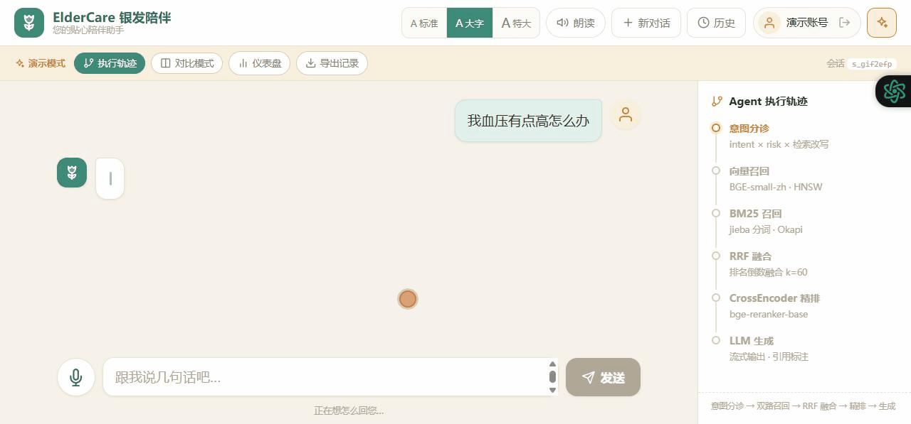
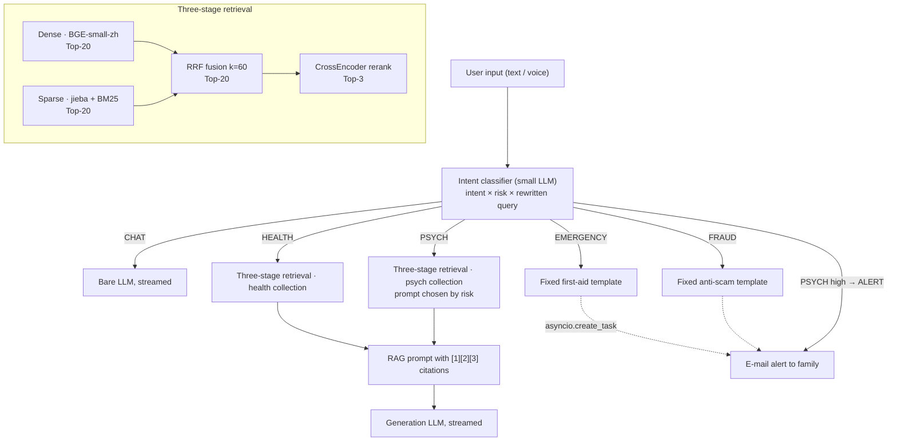

# ElderCare — AI Companion for Older Adults Living Alone

**English** | [中文](README.zh.md)


An AI companion for older adults who live alone, built on **FastAPI and dynamic-routing RAG**.

- **Triage.** Every message is sorted into one of five intents: small talk, health questions, emotional support, medical emergencies and phone scams.
- **Three-stage retrieval** (dense + sparse → RRF → CrossEncoder rerank) keeps the retrieved context relevant.
- **Clickable citations** make every answer traceable to its sources.
- **Family alerts.** In high-risk situations family members get an e-mail in real time.

**Live demo:** https://huggingface.co/spaces/bluegum/eldercare-rag
On the login page, click the one-click demo account button to see a week of preset conversations and the admin dashboard.

> The user interface and the knowledge bases are in Chinese.



## Key features

| Module | What it does |
|---|---|
| Dynamic-routing RAG | Five-way intent triage. One LLM call returns intent, risk level and a rewritten search query. |
| Multi-turn query rewriting | Follow-ups such as "so what should she eat normally?" are rewritten into standalone search queries, so context survives across turns. |
| Three-stage retrieval | Vector + BM25 recall → RRF fusion → BGE-reranker re-ranking. |
| Citations | The LLM writes `[1] [2]` markers. Clicking a badge jumps to the underlying chunk and highlights it, with source and topic tags. A snapshot of what was retrieved is stored with each message, so citations still work in history. |
| Agent trace | In demo mode, a pipeline timeline lights up stage by stage (triage → dual recall → RRF → rerank → generation) with the time each stage took. |
| Comparison mode | The same question is streamed side by side to the full agent and to a bare LLM, to show what RAG adds. |
| Accounts and history | Login, sign-up and a one-click demo account (standard-library PBKDF2 + server-side tokens). Past conversations can be reopened and continued. Auth uses a Bearer header so it works inside the cross-site Hugging Face iframe. |
| Long-term memory | A small model extracts a user profile asynchronously (health, family, habits, schedule) and injects it into later conversations. Demo mode shows "what I remember". |
| Asynchronous alerts | High-risk cases send e-mail through `asyncio.create_task`, so streaming is never blocked. |
| Three log levels | INFO is archived, WARN goes into a daily summary e-mail, ALERT is sent immediately. This avoids alert fatigue for family members. |
| Admin dashboard | `/admin` with dependency-free SVG charts: intent mix, level mix, 14-day trend, recent alerts. Protected by `ADMIN_TOKEN`. |
| Accessibility and mobile | Chinese voice input and output with the Web Speech API, three font sizes, two-row top bar on mobile. No dependencies, no cost. |
| Quantitative evaluation | LLM-as-judge comparison of three retrieval pipelines on a 30-question set. |

## Evaluation

**Intent classification** (21 labelled samples covering five intents × three risk levels; `qwen3.5-flash` with few-shot JSON output):

| Metric | Accuracy |
|---|---|
| Five-way intent | **21/21 = 100%** |
| Risk level (when the intent is correct) | **21/21 = 100%** |

**Retrieval pipelines**: 30 questions × 3 pipelines × 3 RAGAS-style metrics (LLM-as-judge):

| Metric | Vector only | + rerank | + hybrid + rerank |
|---|---|---|---|
| **Context precision** | 75.6% | **78.9%** | 77.8% |
| Faithfulness | 83.3% | 80.0% | 76.7% |
| Answer relevance | 4.63/5 | 4.60/5 | 4.70/5 |

- Re-ranking gives a measured gain of **+3.3 points**.
- Hybrid retrieval gives no clear gain on this corpus, where questions and answers use very similar wording. The analysis is in the `scripts/eval_rag.py` report.

## Architecture



The SSE stream pushes one event per stage (`stage` / `intent` / `retrieved` / `message` / `done`). The trace panel lights up each step live and shows its timing.

## Tech stack

- **Back end:** Python 3.11 / FastAPI / Pydantic / SSE streaming
- **Vector store:** ChromaDB (HNSW + cosine)
- **Embedding:** BAAI/bge-small-zh-v1.5 (local)
- **Reranker:** BAAI/bge-reranker-base (local CrossEncoder, run in a thread pool with `asyncio.to_thread`)
- **Sparse retrieval:** rank-bm25 + jieba (pickle cache on disk, cold start under 1 s)
- **LLM:** Qwen via OpenRouter (generation `qwen3.7-plus`, classification `qwen3.5-flash`, switchable with one env variable)
- **Accounts:** standard-library PBKDF2-SHA256 + server-side tokens + httponly cookie (no new dependencies)
- **Data:** SQLite + aiosmtplib + openpyxl
- **Front end:** plain HTML / CSS / JS + Web Speech API, consistent outline SVG icons, no framework and no build step

## Run locally

```bash
# 1. Install dependencies
pip install -r requirements.txt

# 2. Configure environment variables
cp .env.example .env
# add OPENROUTER_API_KEY to .env

# 3. Build the knowledge bases (required on first run)
python scripts/ingest.py
python scripts/ingest_psych.py

# Optional: load a real open dataset
python scripts/ingest_dataset.py \
    --hf-dataset michaelwzhu/ChatMed_Consult_Dataset \
    --collection health --question-field query --answer-field response \
    --max-rows 10000

# 4. Start the server
uvicorn app.main:app --reload --port 8000
```

Open http://localhost:8000. The star button at the top right turns on demo mode (agent trace, comparison mode and the dashboard link).

**Demo account:** `demo / demo2026` is created at start-up (configurable by env), with a week of preset conversations covering all five intents.

## Knowledge bases

| Collection | Dataset | Entries |
|---|---|---|
| `health` | [michaelwzhu/ChatMed_Consult_Dataset](https://huggingface.co/datasets/michaelwzhu/ChatMed_Consult_Dataset) | 10,000 |
| `psych` | [liuzj288/PsyQA](https://huggingface.co/datasets/liuzj288/PsyQA) | 5,000 |

## Environment variables

| Variable | Required | Meaning |
|---|---|---|
| `OPENROUTER_API_KEY` | yes | OpenRouter API key (set it in Secrets on HF Spaces) |
| `CHAT_MODEL` | no | generation model, default `qwen/qwen3.7-plus` |
| `INTENT_MODEL` | no | intent model, default `qwen/qwen3.5-flash-02-23` |
| `ADMIN_TOKEN` | recommended | admin password; without it `/admin` has no auth (local development only) |
| `DEMO_USERNAME` / `DEMO_PASSWORD` | no | demo account, default `demo / demo2026` |
| `SMTP_HOST/USER/PASSWORD/...` | no | e-mail alerts; if not set, alerts print to stdout |

## Project layout

```
app/                # back end
├── main.py         # FastAPI entry (BM25 built in the background, healthz answers at once)
├── intent.py       # intent classification + multi-turn query rewriting (three outputs in one call)
├── retrieval.py    # three-stage retrieval (retrieve_events streams stage by stage)
├── bm25_store.py   # BM25 sparse index (pickle cache)
├── reranker.py     # CrossEncoder re-ranking (lazy loaded)
├── vector_store.py # Chroma wrapper
├── security.py     # PBKDF2 password hashing + login dependency (standard library only)
├── demo_seed.py    # demo account + preset conversations
├── notifier.py     # asynchronous e-mail alerts
├── templates.py    # prompts and templates
└── routers/        # /agent /chat /auth /conversations /admin

static/             # front end (index.html + admin.html dashboard, no dependencies)
scripts/            # data ingestion and evaluation
```

## Evaluation and tests

```bash
python scripts/eval_intent.py    # intent classification accuracy
python scripts/eval_rag.py       # three-pipeline RAGAS-style comparison (LLM-as-judge)
pytest                           # unit tests (RRF fusion, intent-parsing fallback, password hashing, data layer)
```

Reports are written to `reports/eval_<timestamp>.{json,md}`. Unit tests run on GitHub Actions on every push (see the badge at the top).

## Disclaimer

This project is for learning and technical demonstration only. It **does not replace a doctor's diagnosis or a counsellor**. Model output is for reference only. In an emergency in mainland China, call 120 or a psychological support hotline such as **400-161-9995**.

## Data credits

- [ChatMed_Consult_Dataset](https://huggingface.co/datasets/michaelwzhu/ChatMed_Consult_Dataset) (michaelwzhu)
- [PsyQA](https://huggingface.co/datasets/liuzj288/PsyQA) (liuzj288 community mirror / original thu-coai/PsyQA)
- [BGE models](https://huggingface.co/BAAI) (BAAI)

## License

[MIT](LICENSE)
